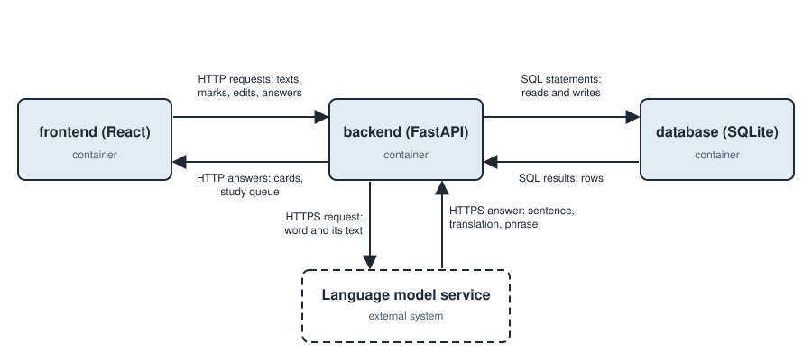

# Architecture

This document records the architecture of the Sentence cards generator, and [the product vision](../product-vision.md) is the scope it serves.

## Drivers

- **Business goals:** [the threshold of success](../threshold-of-success.md) holds the goals the architecture serves.
- **Constraints:** the product vision's [constraints section](../product-vision.md#constraints) holds the conditions the architecture lives inside.
- **Functional requirements:** the [functional requirements index](../functional-requirements/README.md) holds the behavior the architecture must deliver.
- **Quality requirements:** the [quality requirements index](../quality-requirements/README.md) holds the quality the architecture must meet, and it is also the priority matrix.

## Container View

The product runs as the containers below, and [`ADR-001`](adr/ADR-001.md) decides that split and the stack it runs on.

The dashed arrows between the `frontend` and the language model service are decided by [`ADR-004`](adr/ADR-004.md) and are not built yet; today only the `backend` asks the model.

### Container Responsibilities

| Container  | Responsibilities                                                                                                                                                                                                                                       |
| ---------- | ------------------------------------------------------------------------------------------------------------------------------------------------------------------------------------------------------------------------------------------------------ |
| `frontend` | Shows the page where the learner pastes a text and marks words; shows the cards table and the card editor; runs the study session; asks the language model with the user's own key when the user has one; keeps that key in the browser                |
| `backend`  | Makes a card for each marked word by asking the language model with the key that the server holds; repeats a request the model does not answer; refuses a second card with the same meaning; sets when each card comes back and orders the study queue |
| `database` | Stores the texts, the marked words and the cards with their sentences, translations and phrases; stores the due time and the review history of each card; keeps the number of the last change made to its structure                                    |

## Diagrams And Legends

A solid box is a container, with its name and its technology, and a dashed box is an external system.
A solid arrow is one exchange, labelled with what crosses it, and it points to the side that receives it.
A dashed arrow is an exchange that is decided and not built yet.
The image is [`container.svg`](container.svg), written by hand as SVG, so the file is also its source.

## Architectural Decisions

| ADR                       | Status   | Addresses                                                                                                                                     | Decision                                                                    |
| ------------------------- | -------- | --------------------------------------------------------------------------------------------------------------------------------------------- | --------------------------------------------------------------------------- |
| [ADR-001](adr/ADR-001.md) | Accepted | [FR-001](../functional-requirements/fr/FR-001.md), [QR-02](../quality-requirements/qr/QR-02.md), [QR-03](../quality-requirements/qr/QR-03.md) | A React frontend, a FastAPI backend, and an SQLite database                 |
| [ADR-002](adr/ADR-002.md) | Accepted | [QR-02](../quality-requirements/qr/QR-02.md)                                                                                                  | Numbered migrations run once each in order                                  |
| [ADR-003](adr/ADR-003.md) | Accepted | [FR-002](../functional-requirements/fr/FR-002.md), [QR-01](../quality-requirements/qr/QR-01.md), [QR-04](../quality-requirements/qr/QR-04.md) | A configured OpenAI-compatible endpoint, with the retry in the backend      |
| [ADR-004](adr/ADR-004.md) | Accepted | [FR-011](../functional-requirements/fr/FR-011.md), [QR-06](../quality-requirements/qr/QR-06.md)                                               | A user's own model key stays in the browser, and the browser asks the model |
| [ADR-005](adr/ADR-005.md) | Proposed | [QR-03](../quality-requirements/qr/QR-03.md)                                                                                                  | Run the audio model in the backend                                          |
