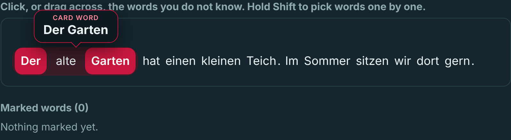
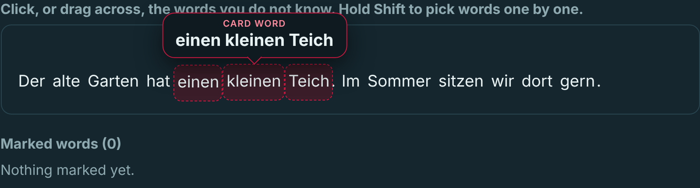
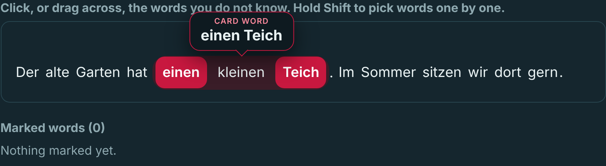

# Selecting several words as one card

Two ways to select several words of a text as one card were tried on a prototype, and the Customer chose one.
This is the evidence for the action point of the Week 3 meeting ([`DEC-022`](../decisions.md#dec-022)) and for the choice recorded in [`DEC-025`](../decisions.md#dec-025).
The code of the prototype is not merged into `main`; only the way the Customer chose is built, in its own task.

## What was asked

The Customer wanted the learner to select several words for a card, and offered two ways to show or make the selection (Week 3 [meeting transcript](../../reports/week-03/meeting-transcript.md)):

- "I think we should somehow let the user select several words for a card." (Customer, [02:30:11])
- "It might be selection with another mouse button, or holding a key on the keyboard and then selecting words, so there should be a way to signal to the service that you select these words together." (Customer, [02:31:52])
- "Another approach is to just show, after selection and on hover, which combination of words was actually selected." (Customer, [02:33:17])

`nataliamotand` also proposed an idea of her own: "if we could hold the button and move it through the words, it would save them as one phrase and show a visualization of them together, and we could unmark an adjective, or the word in the middle, with the right mouse button" ([02:30:37]), and said that screenshots of the options would be sent to the Customer to choose ([02:35:37]).

## What was tried

The look is the same for both ways, and only the way of selecting differs.

- The chosen words become one block with rounded corners, on a soft background that holds the whole phrase.
- A word in the middle that is not chosen stays plain inside the block, so it is clear that the phrase is one card.
- A bubble above the block shows the words of the card, while the learner selects and when the pointer is over a selection (the hover idea of [02:33:17]).

| Way | How the learner selects                                                                                                                               | How a word is taken out                                    |
| --- | ----------------------------------------------------------------------------------------------------------------------------------------------------- | ---------------------------------------------------------- |
| 1   | Hold Shift and click the words one by one; a word in the middle can be skipped. Letting go of Shift and clicking another word starts a new selection. | Shift and a click on a chosen word.                        |
| 2   | Hold the left mouse button and drag across the words; the next drag makes another selection.                                                          | A click on a chosen word (the right button does the same). |

Screenshots of the prototype:

1. Way 1, Shift held, "Der alte Garten" with "alte" left out: 
2. Way 2, drag in progress over "einen kleinen Teich": 
3. Way 2, after a click on "kleinen", the card is "einen Teich": 

## What was sent and the answer

On 2026-10-21 at 22:42 (Moscow time) `nataliamotand` sent this message to the Customer in the group chat, with the three screenshots above (the greeting that names the Customer is left out here):

> Hi! For the action point from the Week 3 meeting, here is how selecting several words as one card looks and works. The screenshots come from a prototype, and its code is not merged.
>
> The look is the same for both ways: the chosen words become one block, a word in the middle can be left out, and a bubble above shows the combination, like the hover idea you suggested. The bubble shows while selecting and on hover. Only the way of selecting differs:
>
> 1. Hold Shift and click the words one by one (image 1); Shift + click on a chosen word takes it out. This is the key-held approach you suggested.
> 2. Hold the left mouse button and drag across the words (image 2); a click on a chosen word takes it out (image 3). This is the idea I described in the meeting.
>
> Which way would you like us to build, and is the look clear enough for the learner?

The Customer answered in the same chat on 2026-10-21 at 23:20:

> I prefer the first option because of verbs with a separable prefix. May be the Shift button on desktop and another visible button on mobile
>
> The second option may not be very convenient when parts of a verb are on different lines

`nataliamotand` replied at 23:21: "Ok, thanks for sharing you opinion".
At 23:23 the Customer sent a headline from a news site with the parts of two verbs marked, and this text:

> A separable verb
> zustimmen -> stimmt zu
>
> An idiom
> sich bereit erklären -> erklärt sich bereit

The headline itself is not kept in the repository.
At 23:33 `nataliamotand` replied: "Oooh, okay! I understood better now. Makes sense. We'll implement it with shift then, it'll be more convenient for the user".

## The words between the chosen ones

The examples sent showed a word left out between chosen words on a pale ground.
The Customer wrote about them: "I think it shouldn't be highlighted at all because it's not a part of the word combination" and "It can be highlighted with a normal color on its own, as a word separate from the word combination" (Customer, chat, 2026-10-22, message edited 07:52).
`nataliamotand` asked: "Ok, I understand the first part of the message, that it shouldn't be highlighted if it's not selected. But I don't quite get what you meant in the second part. Is it just that the user should be able to select it as another card?" (chat, 2026-10-22 10:08), and the Customer answered "Yes" (chat, 2026-10-22 10:18).
This is [`DEC-026`](../decisions.md#dec-026): the word has no mark of the selection, and a click marks it as a card of its own.

## Result

The way built is the first one: Shift and click ([`DEC-025`](../decisions.md#dec-025)).
Dragging is not built.
The task that builds it is issue #96.

## Open questions

These were not decided by the Customer, and none of them is a requirement yet.

- A visible button for touch screens: the Customer wrote "May be the Shift button on desktop and another visible button on mobile". The product is self-hosted ([`DEC-008`](../decisions.md#dec-008)); whether a touch screen is in scope is to be asked.
- Words on different lines: in the examples of the Customer the parts of a verb can be far apart or on different lines, and the block of the prototype is drawn for words on one line. How the selection looks across lines is to be decided in the task that builds it.
- The word of the card: the Customer wrote the form of the dictionary ("zustimmen") next to the form of the text ("stimmt zu"). Whether the card keeps the text as selected or also the form of the dictionary is to be asked.

## Deviation from the task issue

Issue #95 says the second way is the tooltip on hover (AC-02).
The tooltip came from the Customer as a way to show the selection ([02:33:17]), not as a way to select, so it is in both ways, and the second way tried is the drag of `nataliamotand` ([02:30:37]).
