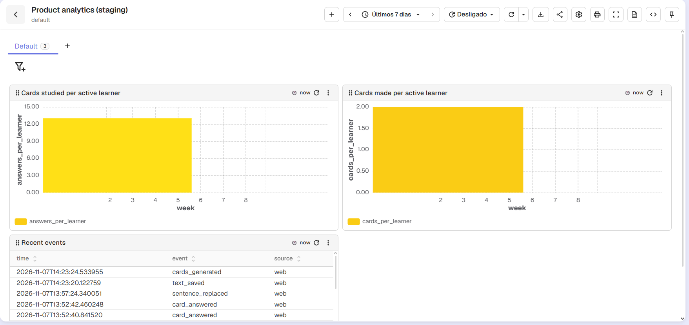
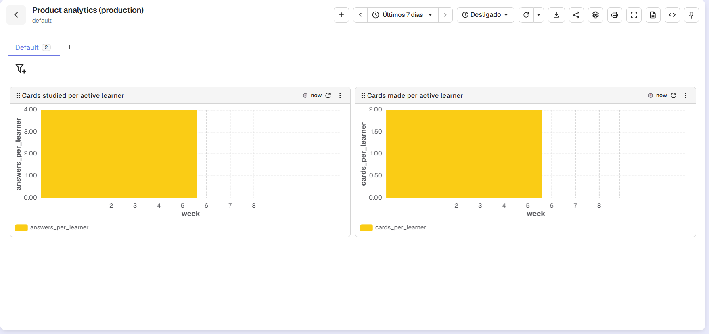
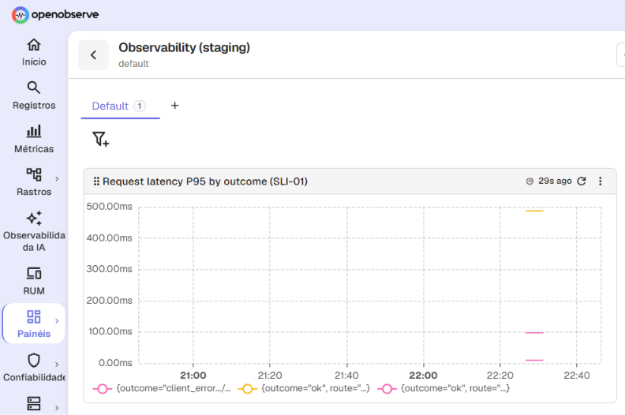
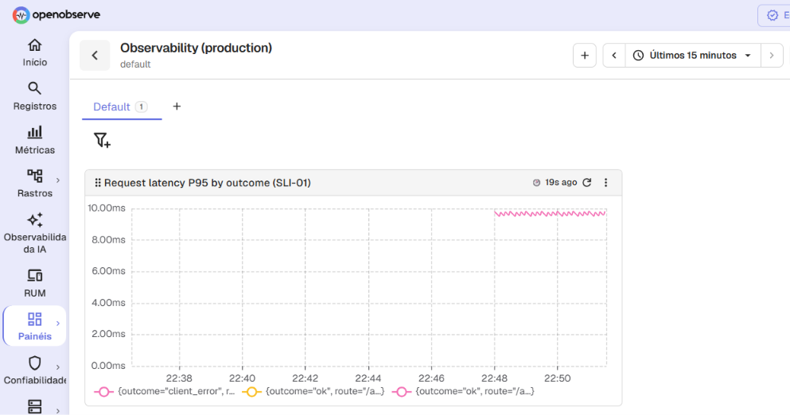

# Week 06 report

## Project

Sentence cards generator, team 6.
Assignment 6, Product Analytics, Observability, And The Week 6 Release: the analytics plan and its events, the observability plan and its service level indicators, the four dashboards, the first run of the observability test, the threshold review, the validation meeting and the fourth release of the product.

The testing plan is in [docs/project-plan.md#quality-requirement-testing-plan](../../docs/project-plan.md#quality-requirement-testing-plan), and the rows that are not `Passes` are only there.

Start with the [meeting report](meeting-report.md), the [project plan](../../docs/project-plan.md#sprint-06) and the [result of the observability test](qrt-01-evidence.md).

## What we did

The product records four events about its use, without any text, name or e-mail address, and the team reads them on one analytics dashboard in staging and one in production ([`docs/analytics.md`](../../docs/analytics.md)).
The backend emits its request signals, and the team reads them as `SLI-01` on one observability dashboard in staging and one in production ([`docs/observability.md`](../../docs/observability.md)).
Both telemetry backends run on the university network, and the product only sends data to them when its configuration turns that on ([`docs/deployment.md`](../../docs/deployment.md)).
We also gave each learner a library of their own with a code, and added the decks apart from the texts, with the Study page and its deck requirements.
We cut the fourth release, `REL-06`, as [v0.3.0](https://github.com/itpd-team-6/sentence-cards-generator-team-6/releases/tag/v0.3.0).

The focus metric, [cards studied per active learner per week](../../docs/analytics.md#cards-studied-per-active-learner-per-week), has no value yet.
The events on the dashboards come from the team's own use of the product, tagged `source = web`, and we cannot show that a learner outside the team has used it, so we do not present them as a value.
It needs learners outside the team who answer cards while the product records events, and the Week 7 usability work is the first chance to have them.
The metric is computed in the dashboard by its query, and not by hand:

```sql
SELECT date_trunc('week', to_timestamp_micros(_timestamp)) AS week,
       count(*) * 1.0 / count(DISTINCT learner_id) AS answers_per_learner
FROM "events"
WHERE event = 'card_answered' AND source != 'smoke'
GROUP BY week
ORDER BY week
```

What moved out of the sprint: four tasks moved from `SPRINT-06` to `SPRINT-07`, with their reasons under Deviations.
The two internal stories, `US-13` and `US-14`, and the decks story `US-11` were completed, and the actual velocity of the sprint is in [the plan](../../docs/project-plan.md#sprint-06).

## Analytics

The dashboards show the metric that the query above computes.

- [Cards studied per active learner, staging](images/analytics-staging.png): the chart `Cards studied per active learner` runs the query of the [focus metric](../../docs/analytics.md#cards-studied-per-active-learner-per-week), and the event list shows the recent events and their `source`.
- [Cards studied per active learner, production](images/analytics-production.png): the same chart with the same query.
- The second chart of both dashboards, `Cards made per active learner`, shows [cards made per active learner per week](../../docs/analytics.md#cards-made-per-active-learner-per-week).





## Observability

The test [`QRT-01`](../../docs/quality-requirements/qr/QR-07.md#qrt-01) of [`QR-07`](../../docs/quality-requirements/qr/QR-07.md) passed on staging on 2026-11-07, and the Customer accepted `QR-07` after the team showed it in the meeting ([`DEC-055`](../../docs/decisions.md#dec-055)).
The failed request was the request for the cards of a text that does not exist, answered 404.

- **Request identifier (`request_id`):** `9aa9cad811644497ade8a64fd1906e20`.
- **Route:** `/api/texts/{text_id}/cards`.
- **Failure label (`outcome`):** `client_error`.
- **Log point:** found 0.9 seconds after the response, and the measure allows five seconds.
- **Failure series of [`SLI-01`](../../docs/observability.md#sli-01):** found 9.0 seconds after the response, and the measure allows one minute.

The full record, with what the run does not show, is in the [result of the run](qrt-01-evidence.md).

- [`SLI-01` request latency by route and outcome, staging](images/observability-staging.png): the chart `Request latency P95 by outcome (SLI-01)`.
- [`SLI-01` request latency by route and outcome, production](images/observability-production.png): the same chart.





## Threshold review

The review took place in the validation meeting of 2026-11-08, and the full record is in the [meeting report](meeting-report.md).

| Goal                                                | Current measure                                                                                               | New data can settle it                                                                       | Proposal |
| --------------------------------------------------- | ------------------------------------------------------------------------------------------------------------- | -------------------------------------------------------------------------------------------- | -------- |
| [TOS-01](../../docs/threshold-of-success.md#tos-01) | The Customer's recorded acceptance of `US-01`, `US-02` and `US-03`, each as a `DEC-nnn`, by the end of Week 9 | No: it is the Customer's decision, and the events and the signals do not record it           | None     |
| [TOS-02](../../docs/threshold-of-success.md#tos-02) | One person outside the team who installs and runs the product by following only `setup.md`, in Week 9         | No: the events and the signals do not show who installed the product or where they got stuck | None     |
| [TOS-03](../../docs/threshold-of-success.md#tos-03) | One person outside the team who pastes a text, marks words, gets the cards and studies them, in Week 9        | No: the events carry no name, so they cannot show that the person is outside the team        | None     |
| [TOS-04](../../docs/threshold-of-success.md#tos-04) | The demonstration of the product at the final project defense, in Week 11                                     | No: it is a demonstration at the defense                                                     | None     |

- [TOS-01](../../docs/threshold-of-success.md#tos-01) is `Open`: it was `Achieved` for the acceptance of the three stories, but its success statement says that the Customer accepts the product as the final result of the semester, and that is not fulfilled yet, so nataliamotand said in the meeting that the status would be corrected to `Open` ([01:21:59]), and the Customer said that it could be discussed later ([01:23:00]).
- [TOS-02](../../docs/threshold-of-success.md#tos-02) is `Open`: no person outside the team has followed `setup.md` yet, and the goal is due in Week 9.
- [TOS-03](../../docs/threshold-of-success.md#tos-03) is `Open`: no person outside the team has gone from a pasted text to studying the cards, and the goal is due in Week 9.
- [TOS-04](../../docs/threshold-of-success.md#tos-04) is `Open`: the demonstration is at the final project defense, in Week 11.

The team proposed no measure, because the data of this week does not settle any goal: the analytics events and the observability signals describe the use of the product and its operation, and each measure asks for a person outside the team or for a decision of the Customer.
The Customer decided that the thresholds stay as they are for now ([`DEC-062`](../../docs/decisions.md#dec-062)).

## Customer meeting outcome

The meeting was on 2026-11-08, and the full record is in the [meeting report](meeting-report.md).

- The Customer accepted `QR-07` after the team showed the result of `QRT-01` on the observability dashboard ([`DEC-055`](../../docs/decisions.md#dec-055)).
- For `US-11`, the decks, he said nothing should be added, and asked to close it and to write new stories with more detail ([`DEC-060`](../../docs/decisions.md#dec-060)).
- He asked for a new layout of the study page and of the study session ([`DEC-056`](../../docs/decisions.md#dec-056), [`DEC-057`](../../docs/decisions.md#dec-057)), and the product keeps the texts the learner added and supports several users ([`DEC-058`](../../docs/decisions.md#dec-058), [`DEC-059`](../../docs/decisions.md#dec-059)).
- The order of the next stories is texts and the interface, then login, then audio, then the mobile version ([`DEC-061`](../../docs/decisions.md#dec-061)).

## Coverage

| Deliverable                 | Artifact                                                                                                                                                                                                                                                          |
| --------------------------- | ----------------------------------------------------------------------------------------------------------------------------------------------------------------------------------------------------------------------------------------------------------------- |
| Sprint plan and new stories | [docs/project-plan.md#sprint-06](../../docs/project-plan.md#sprint-06), and [the two internal stories in the `SPRINT-06` milestone](https://github.com/itpd-team-6/sentence-cards-generator-team-6/milestone/4)                                                   |
| Analytics plan              | [docs/analytics.md](../../docs/analytics.md), with the [metric tree](../../docs/analytics.md#the-metric-tree) and a section per metric                                                                                                                            |
| Events and instrumentation  | [docs/analytics.md#the-events](../../docs/analytics.md#the-events)                                                                                                                                                                                                |
| Analytics dashboards        | [analytics-staging.png](images/analytics-staging.png) and [analytics-production.png](images/analytics-production.png), linked with the metric each chart shows in the analytics section above                                                                     |
| Observability plan and SLIs | [docs/observability.md](../../docs/observability.md)                                                                                                                                                                                                              |
| Observability dashboards    | [observability-staging.png](images/observability-staging.png) and [observability-production.png](images/observability-production.png), linked with the `SLI` each chart shows in the observability section above                                                  |
| Feature documentation       | [docs/features.md](../../docs/features.md)                                                                                                                                                                                                                        |
| Functional requirements     | [docs/functional-requirements/README.md](../../docs/functional-requirements/README.md), with [`FR-016`](../../docs/functional-requirements/fr/FR-016.md) and [`FR-017`](../../docs/functional-requirements/fr/FR-017.md)                                          |
| ADRs and container view     | [docs/architecture/adr/README.md](../../docs/architecture/adr/README.md) and [docs/architecture/README.md#container-view](../../docs/architecture/README.md#container-view)                                                                                       |
| Observability requirement   | [`QR-07`](../../docs/quality-requirements/qr/QR-07.md) and its [`QRT-01`](../../docs/quality-requirements/qr/QR-07.md#qrt-01)                                                                                                                                     |
| Runtime test re-run         | Not run; see Deviations                                                                                                                                                                                                                                           |
| Threshold review            | [reports/week-06/README.md#threshold-review](#threshold-review)                                                                                                                                                                                                   |
| Week 5 action points        | [reports/week-06/meeting-report.md#previous-action-points](meeting-report.md#previous-action-points)                                                                                                                                                              |
| Week 5 open questions       | [reports/week-06/meeting-report.md#previous-open-questions](meeting-report.md#previous-open-questions)                                                                                                                                                            |
| Meeting script              | [reports/week-06/meeting-script.md](meeting-script.md)                                                                                                                                                                                                            |
| Meeting transcript          | [reports/week-06/meeting-transcript.md](meeting-transcript.md)                                                                                                                                                                                                    |
| Customer validation         | [reports/week-06/meeting-report.md](meeting-report.md), and [`DEC-062`](../../docs/decisions.md#dec-062) for the threshold decision                                                                                                                               |
| `REL-06`                    | [the tag v0.3.0](https://github.com/itpd-team-6/sentence-cards-generator-team-6/releases/tag/v0.3.0), its release body, [the changelog's released section](../../CHANGELOG.md#030---2026-11-08), and [the plan's REL-06 block](../../docs/project-plan.md#rel-06) |
| Sprint retrospective        | [reports/week-06/sprint-retrospective.md](sprint-retrospective.md)                                                                                                                                                                                                |
| AI usage                    | [reports/week-06/ai-usage.md](ai-usage.md)                                                                                                                                                                                                                        |

The Customer permitted recording and publishing a transcript, so we produced a [transcript](meeting-transcript.md).

## Contribution

| Member               | Work                                                                                                                                                                                                                                                                                                                                                                                                                                                                                                                                                                                                                                                                                                                                                                                                                                                                                                                                                                                                                                                                                                                                       |
| -------------------- | ------------------------------------------------------------------------------------------------------------------------------------------------------------------------------------------------------------------------------------------------------------------------------------------------------------------------------------------------------------------------------------------------------------------------------------------------------------------------------------------------------------------------------------------------------------------------------------------------------------------------------------------------------------------------------------------------------------------------------------------------------------------------------------------------------------------------------------------------------------------------------------------------------------------------------------------------------------------------------------------------------------------------------------------------------------------------------------------------------------------------------------------ |
| nataliamotand        | [PR #202](https://github.com/itpd-team-6/sentence-cards-generator-team-6/pull/202) (decks apart from the texts), [PR #205](https://github.com/itpd-team-6/sentence-cards-generator-team-6/pull/205) (the Study page and the deck requirements), [PR #210](https://github.com/itpd-team-6/sentence-cards-generator-team-6/pull/210) (a library of their own for each learner), [PR #211](https://github.com/itpd-team-6/sentence-cards-generator-team-6/pull/211) (product events and the analytics plan), [PR #216](https://github.com/itpd-team-6/sentence-cards-generator-team-6/pull/216) (the request signals of the backend), [PR #217](https://github.com/itpd-team-6/sentence-cards-generator-team-6/pull/217) (the observability plan, `FR-017`, `ADR-008` and `QR-07`), [PR #219](https://github.com/itpd-team-6/sentence-cards-generator-team-6/pull/219) (the result of `QRT-01`), [PR #221](https://github.com/itpd-team-6/sentence-cards-generator-team-6/pull/221) (the meeting script and the outcome of `TOS-01`), [PR #241](https://github.com/itpd-team-6/sentence-cards-generator-team-6/pull/241) (the meeting record) |
| AbdelrahmanAbdel-Aal | [PR #223](https://github.com/itpd-team-6/sentence-cards-generator-team-6/pull/223) (container view), [PR #225](https://github.com/itpd-team-6/sentence-cards-generator-team-6/pull/225) (glossary terms), [PR #228](https://github.com/itpd-team-6/sentence-cards-generator-team-6/pull/228) (sprint retrospective), [PR #239](https://github.com/itpd-team-6/sentence-cards-generator-team-6/pull/239) (AI usage)                                                                                                                                                                                                                                                                                                                                                                                                                                                                                                                                                                                                                                                                                                                         |
| emapfff              | [PR #231](https://github.com/itpd-team-6/sentence-cards-generator-team-6/pull/231) (the observability feature entry and its glossary terms), [PR #237](https://github.com/itpd-team-6/sentence-cards-generator-team-6/pull/237) (the plan of `SPRINT-06`), [PR #242](https://github.com/itpd-team-6/sentence-cards-generator-team-6/pull/242) (the `REL-06` block of the plan), [PR #244](https://github.com/itpd-team-6/sentence-cards-generator-team-6/pull/244) (the changelog of `REL-06`)                                                                                                                                                                                                                                                                                                                                                                                                                                                                                                                                                                                                                                             |

## Repository evidence

- A merged pull request that closed its task issue: [PR #241](https://github.com/itpd-team-6/sentence-cards-generator-team-6/pull/241), which closed [issue #240](https://github.com/itpd-team-6/sentence-cards-generator-team-6/issues/240).
- The latest green runs on `main`, all on the commit `02e906f`: [the link check and the Markdown check](https://github.com/itpd-team-6/sentence-cards-generator-team-6/actions/runs/42505097111) (jobs `lychee` and `Markdown lint`), [`actionlint`](https://github.com/itpd-team-6/sentence-cards-generator-team-6/actions/runs/42505097129) (workflow `Workflow lint`), [the product code checks](https://github.com/itpd-team-6/sentence-cards-generator-team-6/actions/runs/42505097117) (workflow `Product CI`) and [the documentation site](https://github.com/itpd-team-6/sentence-cards-generator-team-6/actions/runs/42505097113).
- Excluded links, in [.lycheeignore](../../.lycheeignore): no entry was added or changed in Week 6, and the reasons are in the [Week 01 report](../week-01/README.md#repository-evidence).

## Deviations

- Only nataliamotand attended the meeting, with no roles: emapfff and AbdelrahmanAbdel-Aal did not join, so the meeting had no note-taker or observer.
- The recording had started before we asked for permission, and we did not ask about sharing it privately; see the metadata of the [meeting report](meeting-report.md#metadata).
- The optional re-run of a runtime test was not run.
- The open questions of Week 5 about a second card for the same meaning, the re-ordering of the queue with the daily limits and the offline mobile version were not put to the Customer: the team judged that the answers are not needed to build or implement the product now, so the questions are dropped; see the [previous open questions](meeting-report.md#previous-open-questions).
- The review asked for no rework in the week, so the commit reviewed in the meeting is the final commit and the tag is on it; the changes to the interface that the Customer asked for are planned for `SPRINT-07`.
- The deck "Earlier cards" is kept per language pair and not per text, as [`DEC-020`](../../docs/decisions.md#dec-020) set.
- Four rows planned for `SPRINT-06` moved to `SPRINT-07`: [issue #165](https://github.com/itpd-team-6/sentence-cards-generator-team-6/issues/165), because the time of the sprint went to the decks, the libraries, the analytics dashboards and the observability setup, as the [sprint retrospective](sprint-retrospective.md#what-did-not) says; and [issue #172](https://github.com/itpd-team-6/sentence-cards-generator-team-6/issues/172), [issue #204](https://github.com/itpd-team-6/sentence-cards-generator-team-6/issues/204) and [issue #212](https://github.com/itpd-team-6/sentence-cards-generator-team-6/issues/212), because the team did not finish them in the sprint and scheduled them for the next one.
- The tests `QR-03 QRT-01` and `QR-06 QRT-01` are `Not verified` and planned for `SPRINT-07`, as the [testing plan](../../docs/project-plan.md#quality-requirement-testing-plan) shows.

## Privacy

No private-only material was committed to this repository.
