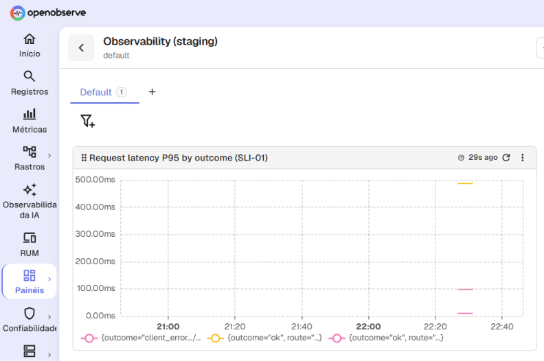
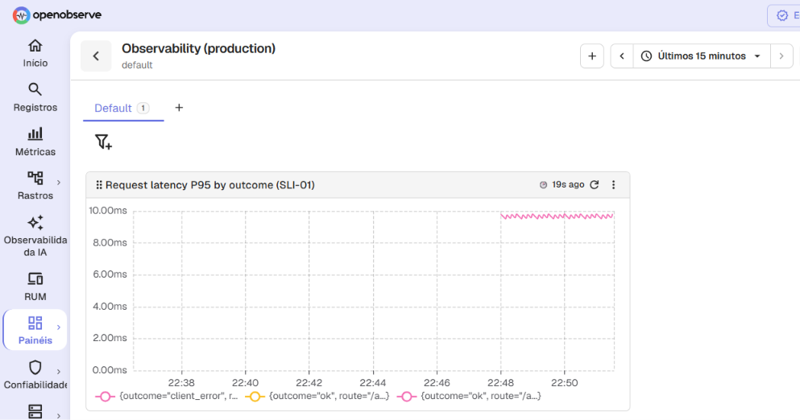

# QRT-01 Of QR-07: Result Of The Run On Staging

The test [`QRT-01`](../../docs/quality-requirements/qr/QR-07.md#qrt-01) of [`QR-07`](../../docs/quality-requirements/qr/QR-07.md) passed on 2026-11-07.

## The run

- **Date:** 2026-11-07.
- **Run by:** nataliamotand, from a machine on the university network, with `node scripts/check-sli.mjs`.
- **Deployment:** staging, running commit `3c60d8aec9a484b422eaaccaba1d907973d31541`.
- **Result:** passed.

## The values the script printed

- **Failed request:** the request for the cards of a text that does not exist, answered 404.
- **Route:** `/api/texts/{text_id}/cards`.
- **Outcome:** `client_error`.
- **`request_id`:** `9aa9cad811644497ade8a64fd1906e20`.
- **Log point:** found 0.9 seconds after the response (the measure allows five seconds).
- **Failure series of `SLI-01`:** found 9.0 seconds after the response (the measure allows one minute).
- **P95 of the failure series:** 97.5 ms.

## What the run shows, and what it does not

The P95 comes from the buckets of a histogram, so it is an interpolation, and it comes from one small sample of test traffic.
The run shows that the signals work from the request to the query.
It does not measure how fast the product is for real learners.

## The dashboards

The chart `Request latency P95 by outcome (SLI-01)` in the dashboard `Observability (staging)`:

The same chart in the dashboard `Observability (production)`:

The script is not run against production, so its chart shows the requests that the production deployment has served since collection was switched on.
